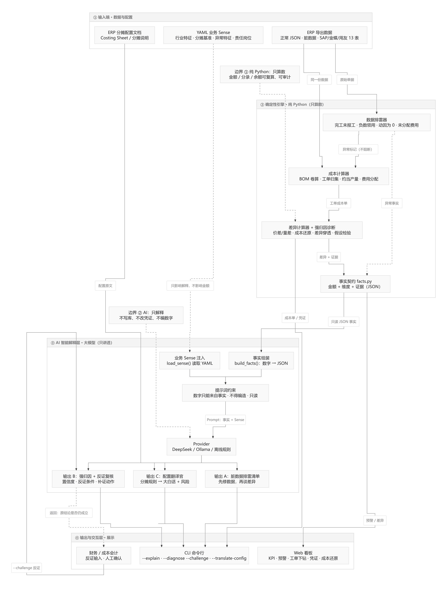

# ERP-Cost-Copilot


**坐在财务总监旁边的成本排雷助手。**

不是再做一个「ERP 成本计算器」——账由 ERP 算，Copilot 负责在月结前把
「哪里不对、为什么、该找谁、什么能推翻它」讲清楚。底层是确定性引擎（可复算、可审计），
上层是业务 Sense + 大模型；没有模型也能离线跑出排雷清单。

财务懂成本但不懂 ERP 表结构，IT 懂系统但不懂成本口径。这个项目把中间那段——归集、分配、
结转、差异——做成可复算的代码，再让 AI 把结果翻译成业务能执行的动作和能反驳的结论。

> **AI 只解释，不改账。** 所有金额来自确定性引擎，逐单可复算、可审计；模型输出是建议，
> 不自动生成或修改凭证，也不替代审批。

## 架构

```text
ERP 导出（BOM / 工单 / 领料 / 报工 / 费用 / 期初余额）
        │
        ▼
[1] 纯 Python 核心引擎
    归集 · 分配 · 逐级结转 · 约当产量 · 差异六项 · 凭证 · 试算 · 结账 · 跨期
        │  结构化事实（差异 / 预警 / 在产 / 余额）
        ▼
[2] 数据排雷 + 强归因 + 业务 Sense
    单据异常 · 假设检验 · 证据链 · 反证条件 · 行业模板
        │
        ▼
[3] Copilot 层
    排雷清单 · 配置翻译 · 反证复核 · DeepSeek / Ollama / 离线兜底
        │
        ▼
Web 看板 / 月结报告 / CLI
```

<details>
<summary><b>业务逻辑思维导图（点击图片查看原图）</b></summary>

<a href="docs/assets/erp-cost-copilot-mindmap.jpg">
  
</a>

</details>

> 蓝色是纯 Python 引擎（只算数），紫色是 AI 层（只解释），虚线是只读 / 建议。

## AI 排雷示例：先修数据，再谈差异

演示数据里故意埋了三类脏数据（`data/dirty_erp_export.json`）：

| 问题 | 位置 | 后果 |
|---|---|---|
| 完工未报工 | PO-1002 完工 690、报工 0 小时 | 人工 0、费用未吸收，成本被低估 |
| 负数领用无退料 | MI-1016 领用 RM-ABS −10 | 材料成本被直接冲减 |
| 分摊动因为 0 | CC-PAINT 费用 1,200，无任何报工 | 费用整笔挂账，未分配 |

```bash
python -m costcontrol.cli --data data/dirty_erp_export.json --explain --offline
```

```text
## 总体结论
2026-10 实际成本 57,824.91，标准 58,545.34，总差异 -720.43（-1.23%）；
未分配制造费用 1,460.00，预警 7 条，数据异常 4 条。
先修数据异常，再看差异；否则「节约/超支」可能只是单据缺失造成的假象。

## 数据排雷（先修数据，再谈差异）
1. [高] 完工未报工 · PO-1002
   - 事实：完工 690、废品 2，但报工 0 小时：人工 0.00、制造费用 0.00，成本被低估。
   - 动作：补录报工单；确认是否委外、计时漏登或跨期报工
   - 责任：生产统计 / 车间主任
2. [高] 分摊动因为 0 · CC-PAINT
   - 事实：喷涂车间 本期费用 1,200.00，但工时动因为 0，整笔挂账未分配。
   - 动作：补录该中心工时/机器工时；确认费用是否应转由其他中心承担
3. [中] 负数领用无退料标记 · MI-1016
   - 事实：PO-1002 领用 RM-ABS -10，但未标记退料，材料成本被直接冲减。
   - 动作：补退料单或冲销负数领用；核对是否串单、错单

## 差异排查
1. **工单超支 · PO-1001｜1,318.97**
   - 归因：本期差异主要来自 费用耗费 470.87、材料价差 388.50
```

注意顺序：**它先报「完工没报工」和「动因为 0」，再报超支。**
因为数据不可信时，差异没有意义。这正是 Copilot 和「成本计算器」的区别。

## 排雷工单化：从清单到待办，再到复跑

清单只能看，工单才能追。每条异常会生成一张带责任人、截止日、补证动作的工单：

```bash
python -m costcontrol.cli --data data/dirty_erp_export.json --tasks --as-of 2026-10-31
```

```text
## 排雷工单 · 2026-10
共 4 条，未完成 4 条；截止日基准 2026-10-31（高 1 天 / 中 3 天 / 低 5 天）。

编号                             级别  事项                          责任人               截止日      补什么                                                   状态
T-ORDER-NO-LABOR-f84f            高    完工未报工 · PO-1002          生产统计 / 车间主任  2026-11-01  补录报工单；确认是否委外、计时漏登或跨期报工             待处理
T-DRIVER-ZERO-ea6f               高    分摊动因为 0 · CC-PAINT       车间主任 / 设备科    2026-11-01  补录该中心工时/机器工时；确认费用是否应转由其他中心承担  待处理
T-DRIVER-ZERO-42b2               高    分摊动因为 0 · CC-MNT         车间主任 / 设备科    2026-11-01  补录该中心工时/机器工时；确认费用是否应转由其他中心承担  待处理
T-NEGATIVE-ISSUE-NO-RETURN-7ce9  中    负数领用无退料标记 · MI-1016  仓库主管             2026-11-03  补退料单或冲销负数领用；核对是否串单、错单               待处理
```

补证后（演示用 `tools/fix_demo_data.py` 模拟仓库/车间补录），用新导出复跑：

```bash
python tools/fix_demo_data.py
python -m costcontrol.cli --data data/dirty_erp_export_fixed.json --rerun-tasks
```

```text
## 补证后复跑 · 前后对比

指标                 补证前     补证后       变化
数据异常条数              4          1         -3
未分配制造费用     1,460.00     260.00  -1,200.00
实际总成本        57,824.91  61,487.25   3,662.34
高置信诊断                6          6         +0
中/低置信诊断        26 / 3     31 / 1    +5 / -2
PO-1002 单位成本      15.35      17.77       2.42
PO-1003 单位成本      50.24      54.94       4.70

已消除：
- 完工未报工 · PO-1002
- 分摊动因为 0 · CC-PAINT
- 负数领用无退料标记 · MI-1016

仍存在：
- 分摊动因为 0 · CC-MNT
说明：剩余项可能是结构性缺口（如辅助部门本就没有报工），需要改配置而不是补单。
```

如果逐条标记完成（`--task-done <编号>`），最后一条关闭时会自动触发复跑对比。
**注意补证后总成本反而上升 3,662.34——这才是真相：之前的「节约」是漏记成本。**

## 强归因与反证：结论可以被挑战

`--attribute` 把差异落到部门；`--diagnose` 继续往下问：**为什么、凭什么、什么能推翻它。**

```text
3. [材料量差] RM-SS304 · PO-1001  285.60
   主因：净领用超耗（已扣退料）（置信 中 0.54）
   · 超领 23.8（4.17%）
   · 已退料 5，净领仍高于标准
   反证：若存在未入账退料，或报废单能覆盖差额，则不是真实超耗
   备选：报废未足额上报（0.20）

1. [材料价差] SF-BODY · PO-1003  680.13
   主因：上游工单成本转入（置信 高 0.80）
   · 半成品 SF-BODY 本期由 PO-1001 生产
   · 上游工单差异合计 953.48（同向传导）
   反证：若上游工单按标准价结转或差异方向相反，则不是上游问题
```

财务不认同？把反证直接丢回去，Copilot 会重新评估置信度，而不是硬撑：

```bash
python -m costcontrol.cli --diagnose --challenge "车间说他们已经退料了，只是单据没录" --offline
```

```text
## 反证复核 · 材料量差 · RM-SS304 · PO-1001
- 原结论：净领用超耗（已扣退料）（置信 中 0.54）
- 复核：反证直接命中主因：如果「已退料只是单据没录」属实，现有证据链不完整，
  置信度由 0.54 下调到 0.29。
- 调整后：低（0.29）→ 原结论暂不成立，转人工核实。
- 下一步：
  1. 调取退料单与仓库红字入库记录；若确已退料未录，补单后重跑归因。
  2. 补证后重新运行 --diagnose，对比调整前后的置信度与主因。
```

### 结构化反证：工具调用 + 校验 + 回退

接入 DeepSeek / Ollama 时，模型不再自由写 Markdown，而是必须调用
`update_confidence` 工具返回结构化裁决：

```text
update_confidence(
  verdict, hit_evidence, adjusted_score, rationale, actions
)
```

- `hit_evidence` 只能引用 `E1..En`，不能自造证据；
- `adjusted_score` 有 0–1 边界，且没有新证据时上调不得超过 0.10、下调不得超过 0.50；
- `verdict` 与分数必须自洽：`upheld` / `weakened` / `overturned` / `needs_evidence`；
- `actions` 1–3 条，每条必须带 `owner`、`action`、`evidence_needed`；
- 任何一项不通过，直接回退离线规则，并打印原因：

```text
> 结构化输出未通过校验（adjusted_score 超出 0–1：1.4），已回退离线规则。
```

通过校验的裁决会追加到 `data/challenges_<期间>.jsonl`，记录原分数、调整分数、
命中证据、模型与回退原因，便于审计和后续学习。
实现细节与审计字段见 [docs/structured-challenge.md](docs/structured-challenge.md)。

归因强度分四层：

| 层级 | 做法 | 命令 |
|---|---|---|
| 1 规则映射 | 成本要素 → 部门 / 岗位 | `--attribute` |
| 2 证据链 | 每条结论列出单据与数字 | `--facts` 的 evidence |
| 3 假设检验 | 候选原因打分、排序、排除 | `--diagnose` |
| 4 反证复核 | 工具调用重估 + Schema/语义校验 + 回退 | `--challenge` |

## ERP 配置翻译：把分摊文档讲成人话

```bash
python -m costcontrol.cli --translate-config data/erp_allocation_config.txt \
  --data data/dirty_erp_export.json --offline
```

```text
## 这条配置在说什么
- 电费：按机器工时，分给 总装车间 40%、喷涂车间 35%、质检中心 25%。
- 折旧：按机器工时，分给 总装车间 50%、喷涂车间 30%、质检中心 20%。
- 管理薪酬：按人工工时，分给 总装车间。
- 电费：按产量，分给 喷涂车间。

## 可能踩的坑
- 原文提示数据可能未就绪：「喷涂车间机器工时……本月尚未更新」——分摊基数可能缺失或滞后。
- 电费、折旧都用机器工时分摊，但系统当前按人工工时归集；机器工时需要显式启用。
- 喷涂车间（CC-PAINT）本期没有任何报工，这笔费用可能整笔挂账。

## 建议动作
1. 让数据提供方补齐本期动因，再跑分摊。
2. 确认系统动因是否支持机器工时。
3. 补录喷涂车间报工，或确认费用是否转由其他中心承担。
```

它不只是复述配置，而是把「配置怎么写」和「系统怎么算」之间的缝找出来。
配置原文、结构化解析、业务 Sense 一起进提示词，模型只负责讲清楚，不许编规则。

## 引擎输出（确定性部分）

```bash
python -m costcontrol.cli --detail
```

```text
宁波恒宇电器有限公司  2026-10 成本计算单
工单 4 张 · 成本对象 3 个 · 预警 8 条

二、工单成本
工单     产品      完工/计划       材料      人工  制造费用   实际合计  单位成本       标准      差异  差异率
PO-1001  SF-BODY     695/700  12,218.50  1,064.00  1,245.38  14,527.88   20.9034  13,574.40    953.48   7.02%
PO-1002  SF-BASE     690/700  10,766.40    783.00    884.87  12,434.27   17.8285  12,508.12    -73.85  -0.59%
PO-1003  FG-KT100    450/450  20,061.86  1,504.00  1,536.12  23,101.98   51.3377  21,984.30  1,117.68   5.08%
PO-1004  FG-KT100    150/200   8,916.38    520.00    553.63   9,990.01   51.8478   9,604.98    385.03   4.01%
```

## 为什么是「排雷助手」

- **月结前排查**：不等你打开 Excel，直接告诉你「这几件事不处理，账关不了」；
- **差异归因**：953.48 的超支不是一个数，是「不锈钢涨价 + 23.8 kg 超耗 + 加班 3 小时 + 车间费用超预算」；
- **跨部门沟通**：给采购、车间、财务的是同一份事实，不同的动作建议。

成本核算是 ERP 里最难标准化、也最值得系统化的一块：归集靠单据、分配靠动因、结转靠 BOM 层级，任何一环口径不一致，算出来的数字就无法解释。所以先把「归集 → 分配 → 结转 → 差异 → 预警」做成确定性引擎，再叠 AI 解释层——顺序不能反。

## 现在能做什么

| 能力 | 说明 |
|---|---|
| 数据排雷 | 完工未报工、负数领用无退料、分摊动因为 0 等单据异常，先于差异报出 |
| 排雷工单化 | 异常生成待办（责任人 / 截止日 / 补什么单），补证后复跑并对比异常、未分配、成本与置信度 |
| AI 排雷清单 | 把数据异常、差异、预警与行业 Sense 变成自然语言清单：结论 / 依据 / 动作 / 责任岗位 |
| 反证复核 | 财务输入反证，模型通过 tool call 返回结构化裁决；校验证据 ID、分数跳变与 verdict 自洽，失败回退离线规则 |
| ERP 配置翻译 | 读分摊说明 / Costing Sheet，翻译成大白话，并指出动因未更新、比例不闭合等坑 |
| 可插拔模型 | 兼容 DeepSeek API 与本地 Ollama；无密钥、断网时自动退化为离线规则 |
| 业务 Sense 模板 | YAML 定义 BOM 特征、分摊基准、异常特征与责任岗位，换行业只换配置 |
| 只读解释层 | 不写库、不改凭证；提示词约束「数字只能来自事实」，输出需人工复核 |
| 强归因诊断 | 每条差异给出候选原因、证据链、反证条件与置信度；证据不足明确转人工 |
| 报表级成本体检 | 只有 SAP/金蝶/用友汇总报表时，做趋势、异常与跨表勾稽，不重算成本 |
| 导出覆盖率检查 | 按表头识别单据类型，给出缺失列、能力矩阵与跨表勾稽，先判断数据能做什么 |
| 第二层复算 | 13 表按单据重算材料/人工/费用与在产，与 ERP 成本单逐项对数，并检查标准成本一致性 |
| SAP 标准卡基准 | BOM/工时不可信时，改用 ERP 标准成本卡做四要素差异，并识别系统性偏差 |
| ERP 导出适配 | CSV + 列名映射 YAML；换厂商只换配置，也能反向生成 ERP 形态的示例导出 |
| 规范事实 | 差异事实带维度标签与证据，adapter 与归因层之间唯一契约 |
| 多层 BOM 标准成本卷算 | 损耗率、半成品**完全成本**逐层滚入上层，自动检测 BOM 循环引用 |
| 工单成本归集 | 直接材料（退料负数冲减）、直接人工（报工工时 × 费率）、制造费用池 |
| 制造费用分配 | 按成本中心归集费用池，以实际工时为动因分配到工单，最大余额法消除尾差 |
| 未分配费用识别 | 有费用、无动因的成本中心（如设备维护组）不会被悄悄摊掉，直接挂账告警 |
| 半成品逐级结转 | 按 BOM 层级自底向上计算，半成品按本期实际完工成本（全月一次加权平均）结转给下游 |
| 完工 / 在产拆分 | 约当产量法，材料按投料程度、人工与费用按完工程度分别折算；废品损失由良品负担并单独列示 |
| 标准成本差异分解 | 材料价差 / 量差、人工工资率 / 效率、费用耗费 / 效率，六项之和等于总差异 |
| 成本还原 | 把产成品成本里的半成品转入，逐层拆回原始材料 / 人工 / 制造费用 |
| 差异穿透 | 成品超支 = 自身差异 + 上游工单转入，并给出上游差异构成 |
| 控制规则与预警 | 7 条规则：超耗、工单超支、报废率、未分配费用、费用超预算、标准价结转、无标准成本 |
| 记账凭证 | 领料 / 报工 / 费用发生与分配 / 完工入库全部生成借贷分录，逐张校验平衡 |
| 试算平衡 | 期初余额 + 本期发生 = 期末，期末余额借贷合计为 0 |
| 期末结账检查 | 借贷平衡、期初平衡、费用是否分完、生产成本余额是否等于期末在产、试算是否平衡 |
| SQLite 多期间 | 一套主数据、多个会计期间；金额以 TEXT 存储保持十进制精度；期间可结账锁定 |
| 跨期在产结转 | 关账时按材料/人工/费用快照未完工工单，重开账期自动带入；结账同时结转总账余额 |
| Web 看板 | 标准库 `http.server` 只读看板：KPI、预警、工单下钻、凭证、成本还原 |
| 成本守恒 | 完工入库 + 期末在产 ≡ 工单总成本，每张工单都有测试兜底 |

## 30 秒上手

要求 Python ≥ 3.11，无第三方依赖（YAML 解析器也是自带的）。

```bash
# 1. 先看确定性成本计算单
python -m costcontrol.cli --detail

# 2. 生成 AI 排雷清单（离线规则，不需要任何密钥）
python -m costcontrol.cli --explain --offline

# 3. 打开本地看板
python -m costcontrol.cli --serve
```

其余常用命令：

```bash
# 逐张工单下钻 / 单张工单 / 标准成本卡
python -m costcontrol.cli --order PO-1004
python -m costcontrol.cli --standard

# 记账凭证 + 试算平衡 / 成本还原 + 差异穿透
python -m costcontrol.cli --journal
python -m costcontrol.cli --restore

# 期末结账（未分配费用转管理费用；--strict 直接阻断）
python -m costcontrol.cli --close
python -m costcontrol.cli --close --strict

# SQLite 多期间
python -m costcontrol.cli --db data/cost.db --init
python -m costcontrol.cli --db data/cost.db --import-json data/demo_ningbo.json
python -m costcontrol.cli --db data/cost.db --period 2026-10 --close

# 测试
python -m unittest discover -s tests -v
```

## 接入大模型

解释层只依赖 JSON 事实，模型可换、可本地化、可完全离线。

| 提供方 | 启用方式 | 默认模型 | 说明 |
|---|---|---|---|
| DeepSeek | `CC_LLM_PROVIDER=deepseek` + `DEEPSEEK_API_KEY` | `deepseek-chat` | 走 OpenAI 兼容的 chat/completions |
| 本地 Ollama | `CC_LLM_PROVIDER=ollama` | `qwen2.5:7b` | 数据不出内网，适合敏感账套 |
| 离线规则 | 默认 / `--offline` | — | 无密钥、无网络也能生成清单，结果可复现 |

```bash
# PowerShell
$env:DEEPSEEK_API_KEY="<paste-your-key>"
$env:CC_LLM_PROVIDER="deepseek"
python -m costcontrol.cli --explain

# 本地模型
$env:CC_LLM_PROVIDER="ollama"
$env:OLLAMA_MODEL="qwen2.5:7b"
python -m costcontrol.cli --explain

# 看看模型到底收到了什么（排查幻觉的第一步）
python -m costcontrol.cli --explain --show-prompt
```

调用失败会返回非零退出码并给出原因，不会静默改用别的模型；需要兜底时显式加 `--offline`。

## 业务 Sense：让归因不泛泛

`config_templates/discrete_manufacturing.yaml` 是一份离散制造模板，解释层会把它和事实一起注入提示词：

```yaml
industry: discrete_manufacturing
allocation:
  primary_basis: machine_hours
  notes:
    - "设备维护组等辅助部门应做交互分配，长期挂账说明动因没维护"

anomalies:
  unreturned_material:
    label: "退料未入库"
    signal: "实际领料明显超过标准用量，且没有对应的退料单"
    suggestion: "盘点车间余料并补录退料单；确认是否存在替代料、报废未报"
    owner: "车间主任 / 成本会计"

rule_map:
  MAT-OVERUSE: unreturned_material
```

换行业时复制一份模板，改 `characteristics`（BOM 形态、人工/费用结构）、`allocation`（分摊基准）、
`anomalies`（异常特征与责任岗位）、`rule_map`（预警规则到异常类型的映射），然后用：

```bash
python -m costcontrol.cli --explain --sense config_templates/your_industry.yaml
```

模板只影响**解释与建议**，不影响任何金额计算。

## 没有真实 ERP 导出数据，怎么开工

这是最常被问的问题。答案：**先定契约，再造数据，真实数据最后只改映射。**

```bash
# 1. 把内置演示数据写成「ERP 导出形态」（11 个 CSV，中文表头）
python -m costcontrol.cli --export-csv exports/yonyou_2026_10

# 2. 从导出目录读回来，跑成本与归因
python -m costcontrol.cli --csv exports/yonyou_2026_10 --detail
python -m costcontrol.cli --csv exports/yonyou_2026_10 --attribute
```

- 导出目录是 `01-物料主数据.csv` … `10-期初在产.csv`，列名按用友习惯命名，可直接用 Excel 打开；
- 列名映射在 [config_templates/adapters/yonyou_u8.yaml](config_templates/adapters/yonyou_u8.yaml)，
  换厂商只改这个 YAML，代码零改动；
- 真实数据到手后：复制映射 → 改列名 → `--csv` 读取 → 与 ERP 成本报表对数。

字段最小要求、接入步骤、四条真实数据获取路径，见 [docs/adapter-spec.md](docs/adapter-spec.md)。

## 只有 ERP 导出：先查覆盖率，再做体检与复算

拿到一份导出，先别急着分析，先问「这些表能支撑什么」：

```bash
python -m costcontrol.cli --check-export data/auto_reports
```

```text
CSV 13 个，识别 13 个，未识别 0 个

二、能力矩阵
报表级成本体检    可用
材料差异（六项）  部分    领料未覆盖半成品内部原材料
人工效率差异      部分    工时定额与实际差异过大
制造费用分配      可用
约当产量/在产     可用

三、语义勾稽
✓ 领料金额 vs 成本单材料：18/18 张工单一致
✓ 人工成本 vs 成本单人工：18/18 张工单一致
✓ 废品回收 vs 日报：6/6 季度一致
✓ 单位成本 vs 分项合计：18/18 张工单一致
✗ BOM 物料 vs 领料编码：4/7 覆盖（未领用 RM-ALU/RM-STEEL/RM-CUT，属半成品内部用料）
✗ 标准工时 vs 实际工时：11,175h vs 126,404h（11.3 倍）
```

覆盖率不是打勾清单，而是**能力边界**：材料六项差异只到「部分」，因为半成品内部用料没有单独领用；
人工效率也只到「部分」，因为工时定额与实际差 11 倍。

确认边界后，先做报表体检：

```bash
python -m costcontrol.cli --reports data/auto_reports
```

18 个月的报表是自洽的：单位成本 18/18 勾稽、还原守恒、构成不重复、期间连续。体检仍然抓到三件事：

- **工单异常**：2025-10 返工单单位成本 354.05，偏离均值 +3.23σ；报废率 4.62%、废品损失 2.2 万；
- **结构漂移**：2026H1 单位成本 469.2 vs 2025 年均 450.8（+4.08%），制造费用涨得最快（+6.46%）；
- **废品回收下滑**：金额 -15.19%，拆开是重量 -8.33%、单价 -7.48%，价格因素约 -4,727 元、数量因素约 -4,873 元。

### 第二层：13 表复算，与 ERP 成本单对数

把领料、报工、费用、BOM、工艺路线按单据重算，再和金蝶成本单逐项对：

```bash
python -m costcontrol.cli --auto-parts data/auto_reports --month 2026-06
```

```text
工单 MO-2606-001 · FG-BC-001
  直接材料   1,153,696.40  vs ERP 1,153,696.40
  直接人工   293,700.20  vs ERP   293,700.00
  制造费用   265,900.00  vs ERP   265,900.00
  三项合计   1,713,296.60  vs ERP 1,713,296.40（ERP 另列废品损失 17,100.00）
  完工单位成本 338.53 vs ERP 344.70（本系统拆在产，ERP 按完工数量且含废品损失）
  期末在产成本 13,855.29

标准成本一致性
  BOM+工艺卷算 286.26 元/件  vs SAP 标准 456.93 元/件（-37.35%）
  标准工时 0.125h/件  vs 实际 1.423h/件（11.4 倍）

结论：归集与分配可复算；但 BOM/工时定额与 SAP 标准成本卡不一致，
六项差异暂不可信，应先修定额或改用 ERP 标准成本卡作为基准。
```

这就是第二层的真实结论：**材料、人工、费用三项与 ERP 分毫不差（人工 0.2 元是工时×费率的舍入），
但标准成本体系对不上**。不是引擎算错，是 BOM 只维护到关键件、工艺路线工时是示意值。
一个诚实的归因助手，必须先把这个说出来，而不是拿 286 的标准去判 344 的实际「超支 20%」。

### SAP 标准卡基准：BOM 不可信时的替代基准

```bash
python -m costcontrol.cli --auto-parts data/auto_reports --month 2026-06 --sap-baseline
```

```text
SAP 标准卡基准 · 2026-06
基准：SAP CK13n 18 个月均值 456.93 元/件 × 5,128 件（完工+废品）

项目              实际          标准         差异    差异率
材料      1,153,696.40  1,409,738.48  -256,042.08   -18.16%
人工        293,700.20    451,981.92  -158,281.72   -35.02%
费用        265,900.00    425,162.48  -159,262.48   -37.46%
外协              0.00     56,254.16   -56,254.16  -100.00%
合计      1,713,296.60  2,343,137.04  -629,840.44   -26.88%
单位成本        334.11        456.93      -122.82   -26.88%

判读
- 四项实际全部同向偏离标准，且降幅都在 10% 以上 → 系统性偏差，
  优先怀疑标准卡版本/口径，而不是「全面节约」。
- 材料+外协合并看：1,153,696.40 vs 1,465,992.64（-21.30%）。
- 在标准与本期口径对齐前，不建议把差额归责到采购或车间。
```

关键不是算出 -26.88%，而是**识别出这是系统性同向偏差**：材料、人工、费用、外协
四项全部低于标准 18%–100%，没有一项超支。真实的绩效差异很少这么整齐。
所以结论只能是「标准卡版本/口径待确认」，而不是「车间全面降本」。

方法、边界与扩展方式见 [docs/report-analysis.md](docs/report-analysis.md)、
[docs/coverage.md](docs/coverage.md) 与 [docs/sap-baseline.md](docs/sap-baseline.md)。

## 演示场景

### 脏数据：结账前先排雷

`data/dirty_erp_export.json` 在干净数据上故意埋了三个典型问题：

- **PO-1002 完工未报工**：完工 690、报工 0 小时，人工 0、费用未吸收；
- **MI-1016 负数领用**：领用 RM-ABS −10，却没有退料标记；
- **CC-PAINT 动因为 0**：喷涂车间有 1,200 元费用、有工艺路线，但没有任何报工。

```bash
python -m costcontrol.cli --data data/dirty_erp_export.json --explain --offline
```

输出会先给「数据排雷」四条，再给差异排查——顺序本身就是结论：
**单据不齐时，先别解释差异。** 完整输出见上文「AI 排雷示例」。

也可以拿单条差异做反证复核：

```bash
python -m costcontrol.cli --diagnose --challenge "车间说已经退料了，只是单据没录" --offline
```

### 干净数据：4 张工单覆盖典型情形

数据集是一个虚构的小型组装厂「宁波恒宇电器」，生产电热水壶 KT-100：

```text
FG-KT100 电热水壶
├── SF-BODY 壶身组件（自制半成品）
│   ├── 304 不锈钢板  0.8 kg（损耗 2%）
│   ├── 温控器        ×1
│   └── M4 螺丝       ×4
├── SF-BASE 底座组件（自制半成品）
│   ├── ABS 塑料粒    0.3 kg（损耗 3%）
│   ├── 发热盘        ×1
│   └── M4 螺丝       ×4
├── 电源线  ×1
└── 彩盒    ×1
```

标准成本 48.854 元/台。本期 4 张工单覆盖了成本核算最典型的四类情形：

- **PO-1001 / PO-1002**：半成品工单，一个有报废、一个期末有在产；
- **PO-1003**：整单完工，材料按**实际结转价**领用半成品，暴露出上游超支沿 BOM 向下传导；
- **PO-1004**：部分完工（150 / 200），在产 47 件按约当产量留成本，**不会把在产成本错记到已完工产品上**。

运行后会看到这些真实结论：

```text
[严重] ORDER-OVERSPEND: PO-1001 实际成本 14527.88，标准 13574.40，超支 953.48（7.02%）
[严重] OH-UNALLOCATED: CC-MNT 发生制造费用 260.00，但本期无工单消耗其动因，费用挂账未分配
[警告] MAT-OVERUSE: PO-1001 领用 RM-SS304 595.0000，标准允许 571.2000，超耗 23.8000
[警告] OH-OVERBUDGET: CC-ASM（总装车间）实际费用 3900.00 超预算 3600.00，超支 300.00
```

其中 PO-1001 的 953.48 元差异可以继续拆开：

```text
材料价差 388.50 / 材料量差 285.60 / 人工工资率 0.00 / 人工效率 84.00 / 费用耗费 105.38 / 费用效率 90.00
```

—— 不锈钢涨价（12.00 → 12.30）、超耗（571.2 → 595 kg）、加班（35 → 38 小时）、车间费用超预算（3,600 → 3,900），四个原因各占多少，一目了然。

再往下一层，两个「反直觉」的结论：

```text
PO-1003 差异 1,117.68 = 自身 461.62 + 上游转入 656.05
  ← PO-1001 壶身组件 450 件，转入 680.13
  ← PO-1002 底座组件 450 件，转入 -24.08

FG-KT100 成本结构：材料 87.06% → 75.88%，人工 6.37% → 11.56%，费用 6.57% → 12.56%
```

成品超支的大头不在总装车间，而是上游工单传下来的；账面「材料占 87%」也是假象——还原成原始成本项目后只有 76%，剩下 11 个百分点是半成品里的加工费。

接着把它记进账，并检查能不能关账：

```text
期末结账检查 · 2026-10
[提示·允许] LEDGER-BALANCED: 凭证借贷平衡，合计 122242.81
[提示·允许] OPENING-BALANCED: 期初余额平衡，借方合计 705000.00
[警告·允许] OH-UNALLOCATED: 未分配制造费用 260.00 已转管理费用（凭证 2026-10-018）
[提示·允许] WIP-CARRIED: 期末在产品成本 2345.47，保留在生产成本科目
[提示·允许] COST-CONSERVATION: 生产成本余额 2345.47 = 期末在产 2345.47
[提示·允许] TRIAL-BALANCE: 试算平衡：期末余额借贷合计相等
结论：可以结账
```

试算平衡表里，`5001 生产成本` 期末余额 2,345.47 正好等于两张未完工工单的在产品成本，`5101 制造费用` 结平为 0 —— 成本计算单和总账对得上，这才是「ERP 成本模块」而不是一个成本计算器。

## 计算链路

```text
领料单 ─┐
报工单 ─┼─→ 工单归集 ──→ 约当产量拆分 ──→ 完工入库 / 期末在产
费用单 ─┘         │
                  ├─→ 制造费用池 ──按工时动因分配──→ 工单（尾差补平、余额告警）
                  └─→ 按 BOM 层级排序 ──→ 半成品成本结转给下游工单
                                    │
                                    ├─→ 记账凭证 ──→ 试算平衡 ──→ 期末结账检查
                                    ├─→ 成本还原 ──→ 差异穿透（这笔超支该找谁）
                                    └─→ LLM 解释层 ──→ 排雷清单（先查哪三件）
```

| 模块 | 职责 |
|---|---|
| `models.py` | 主数据、单据、计算结果（只读快照） |
| `dataset.py` | JSON 载入 + 计算前校验（脏数据挡在门外） |
| `standard.py` | BOM 卷算、标准工时、标准成本卡、环检测 |
| `allocation.py` | 费用池归集、动因分配、未分配余额 |
| `costing.py` | 归集、逐级结转、约当产量、差异 |
| `restoration.py` | 成本还原：把半成品成本逐层拆回原始成本项目 |
| `attribution.py` | 差异穿透：自身差异 vs 上游工单转入 |
| `control.py` | 控制规则与预警分级 |
| `accounts.py` | 会计科目表与费用类型映射 |
| `accounting.py` | 凭证生成、试算平衡 |
| `close.py` | 期末结账检查清单 |
| `store.py` | SQLite 持久化、期间与状态机 |
| `web.py` | 只读 Web 看板（`http.server`） |
| `llm_explainer.py` | AI 解释层：事实组装、提示词、DeepSeek / Ollama / 离线兜底 |
| `audit.py` | 数据排雷：完工未报工、负数领用无退料、动因为 0 |
| `config_translator.py` | ERP 分摊配置翻译：规则解析、风险提示、大白话输出 |
| `challenge.py` | 反证复核：tool call 裁决、Schema/语义校验、离线回退 |
| `tasks.py` | 排雷工单：待办生成、状态跟踪、补证前后对比 |
| `yaml_lite.py` | 零依赖 YAML 子集解析（业务 Sense 模板） |
| `run.py` | 一次期末成本计算的编排 |
| `report.py` | 成本计算单、差异分解、标准成本卡、凭证与试算表 |
| `cli.py` | 命令行入口 |

## 多期间与结账锁定

数据落到 SQLite 后，同一套主数据可以承载多个会计期间：

```text
OPEN ──结账检查通过──▶ CLOSED ──显式解锁──▶ OPEN
```

- CLOSED 期间**拒绝覆盖导入**，防止「结完账又改单据」；
- 查询已结账期间仍然允许，报表照常出；
- 金额在库里以 TEXT 存储，取出来再 `Decimal`，不在数据库层损失精度。

细节（表结构、状态机、一致性保证、已知限制）见 [`docs/persistence.md`](docs/persistence.md)。

## Web 看板

```bash
python -m costcontrol.cli --serve
# 成本控制台已启动：http://127.0.0.1:8765/

# 也可以直接看数据库里的某一期
python -m costcontrol.cli --db data/cost.db --period 2026-10 --serve
```

| 路由 | 内容 |
|---|---|
| `/` | KPI、成本构成条、预警、工单成本表 |
| `/order/PO-1003` | 单张工单的材料/人工/费用明细、差异分解、成本去向 |
| `/journal` | 记账凭证与试算平衡表 |
| `/restore` | 成本还原与差异穿透 |
| `/standard` | 标准成本卡 |
| `/api/summary` | KPI 的 JSON 版本 |

没有前端框架、没有 CDN、没有构建步骤：`http.server` 加一段内联样式表，只监听 `127.0.0.1`、只接受 GET。作品集需要「能点开看」的东西，但不值得为此引入一整套 Node 工具链。

## 跨期在产与总账链

演示数据准备了两期：10 月有四张工单、两张未完工；11 月继续做完其中两张，并新开一张。

```bash
# 看 10 月关账后要带到 11 月的在产与余额
python -m costcontrol.cli --data data/demo_ningbo.json --carry

# 跑 11 月：期初在产 + 本期归集
python -m costcontrol.cli --data data/demo_ningbo_2026_11.json --order PO-1004
```

```text
期初在产转入        47        2,212.84  2,130.32   82.52
直接人工 · 总装  2.5 h  28.00     70.00     63.17    6.83
...
合计                          2,448.81  2,296.14  152.67
差异构成：期初沉淀 82.52 + 本期 70.15 = 合计 152.67
```

三条口径：

1. **期初进分子、不进分母。** 总成本 = 期初在产 + 本期归集；约当量仍是「完工 + 期末在产约当」，期初数量已经包含在里面，再加一次会系统性低估单位成本；
2. **差异拆两段。** 期初沉淀差异（上期遗留）+ 本期增量差异（六项分解），两段之和等于工单总差异；
3. **总账一起结转。** 关账时把 5001 等全部科目余额写成下期期初，并校验 `5001 期初 = Σ 期初在产`；否则下一期试算必断。

10 月关账 → 11 月：

```text
5001 期初 2,345.47 + 本期归集 7,563.60 − 完工结转 9,596.44 = 312.63
312.63 正好等于 11 月期末在产，也等于 12 月期初
```

## 关键设计取舍

| 决策 | 选择 | 理由 |
|---|---|---|
| 成本方法 | 分批法（工单）+ 逐步结转分步法 | 组装型按工单组织生产，半成品有独立工单，成本必须随实物逐级流转 |
| 半成品计价 | 本期实际完工成本，全月一次加权平均 | 与实际领用口径一致；用标准价会掩盖上游超支 |
| 在产拆分 | 约当产量法（材料 / 加工分开折算） | 装配型开工集中投料、加工渐进发生，混在一起算会扭曲单位成本 |
| 标准成本口径 | 完全成本逐层滚入 | 上层「标准材料成本」与「实际结转价」同口径，差异才干净 |
| 标准用量基准 | 约当产量，而非完工数量 | 否则在产越多，差异越难看，全是假信号 |
| 分配尾差 | 最大余额法 | 分出去的合计必须等于费用池，一分不差 |
| 废品损失 | 由合格品负担，不单设支出科目 | 教材口径：废品损失计入当月合格品成本；单独列示只用于考核 |
| 记账口径 | 生产成本借方 = 材料+人工+费用，贷方 = 完工入库，余额 = 在产 | 一张 T 型账户就能解释全部成本去向 |
| 数值精度 | `Decimal`，金额 2 位 / 单价 4 位 | 浮点误差会让成本单永远差一分钱 |
| 依赖 | 纯标准库 | 作品集要能被任何人 clone 即跑，不赌环境 |
| 结果形态 | 不可变快照，可重复计算 | 重算不改单据，才谈得上审计与追溯 |
| AI 定位 | 只解释、不改账 | 数字必须可复算可审计；模型输出是建议，需人工复核 |
| 模型接入 | DeepSeek / Ollama / 离线三选一 | 敏感账套可以完全本地化；无密钥时仍有确定性兜底 |
| 差异归因 | 传导金额精确，构成按比例映射 | 上游差异是整张工单的，不会按领用批次拆分，边界如实标注 |

更细的口径与公式见 [`docs/cost-model.md`](docs/cost-model.md)；科目、凭证与结账规则见 [`docs/accounting.md`](docs/accounting.md)；成本还原与差异穿透见 [`docs/cost-restoration.md`](docs/cost-restoration.md)。

## 与 JD 的对应关系

| JD 里的要求 | 本项目里的落点 |
|---|---|
| 深入财务各模块，识别可 AI 化的高价值场景 | 选定「成本归集/分配/结转」这一最依赖口径与规则的场景，而不是泛泛做报表 |
| 需求分析、PRD、业务流程与数据流程设计 | `docs/cost-model.md` 把会计语言翻译成可执行规则：谁归集、按什么动因分配、差异怎么拆 |
| 与财务、IT、数字化团队对齐需求 | 数据集 JSON 即业务接口；规则参数（容差、动因）可配置，不改代码 |
| 打通业务与账务 | 每张凭证可追溯到工单与单据，生产成本余额必须等于期末在产 |
| 把差异落到责任主体 | 差异穿透给出「自身 / 上游工单」的金额拆分，而不是一个笼统的总差异 |
| AI / 大模型在财务落地 | 解释层把差异与预警转成排雷清单，支持 DeepSeek / Ollama / 离线，提示词约束事实边界 |
| 建立产品效能评估体系（工时节省、准确率、差错率） | 差异率、未分配费用金额、超耗件数、报废率都是现成指标，可直接做成看板 |
| 熟悉 SQL / Python / BI | Python 引擎 + SQLite 多期间 + 自建 Web 看板 + JSON API |

## 路线图

- [x] M0 领域模型 + 示例数据集（多层 BOM、工单、领料、报工、费用）
- [x] M1 标准成本卷算 + 归集 + 分配 + 逐级结转 + 约当产量 + 差异 + 预警
- [x] M2 记账凭证 + 试算平衡 + 期末结账检查（未分配费用处理、成本守恒校验）
- [x] M3 SQLite 持久化、多期间、期间状态与结账锁定
- [x] M4 成本还原：成品成本拆回原始项目，差异拆回上游工单
- [x] M5 Web 看板：总览、工单下钻、凭证、成本还原、JSON 接口
- [x] M3.5 期初在产跨期结转 + 总账余额结转（两期演示数据）
- [ ] M3.6 主数据版本、重算审计、CSV 导入、红字冲销
- [x] M6 AI 解释层：LLM 排雷清单 + 业务 Sense 模板（DeepSeek / Ollama / 离线兜底）
- [ ] M7 行业模板扩展：流程制造、项目型；异常领料检测、BOM 异常识别
- [x] M8 场景扩展：联产品 / 副产品、标准成本版本、滚动预算
- [x] v4 差异归因层：规范事实 + 责任映射 + 归因报告（`--attribute`）
- [x] v4 强归因诊断：假设检验 + 证据链 + 反证条件（`--diagnose`）
- [x] 报表级成本体检：只有汇总报表时的趋势 / 异常 / 跨表勾稽（`--reports`）
- [x] 导出覆盖率检查：识别单据、缺失列、能力矩阵、语义勾稽（`--check-export`）
- [x] 第二层复算：13 表归集/分配/在产拆分 + 与 ERP 成本单对账（`--auto-parts`）
- [x] ERP 导出适配：CSV + 列名映射 YAML + 反向生成示例导出（`--csv` / `--export-csv`）
- [x] 数据排雷：完工未报工、负数领用、动因为 0（`--explain` 先报异常）
- [x] 排雷工单化：责任人 / 截止日 / 补证动作，补证后复跑对比（`--tasks` / `--rerun-tasks`）
- [x] ERP 配置翻译：分摊说明 → 大白话 + 风险（`--translate-config`）
- [x] 反证复核：财务反证 → 重估置信度 + 补证动作（`--challenge`）
- [ ] 历史基线与人工反馈学习（连续期间单耗 / 工时 / 价格序列）
- [ ] 真实导出接入：列名映射、编码、与 ERP 成本报表对数
- [ ] SAP / 用友 / 金蝶差异类别对照表（含「无对应」标注）

## 目录结构

```text
cost-control/
├── .github/
│   └── workflows/tests.yml  # CI：3.11–3.14 矩阵
├── costcontrol/          # 引擎（纯标准库）
│   ├── money.py          # Decimal 精度与最大余额法分配
│   ├── models.py         # 领域模型
│   ├── dataset.py        # 数据集载入与校验
│   ├── standard.py       # BOM 卷算 / 标准成本卡
│   ├── allocation.py     # 制造费用分配
│   ├── costing.py        # 归集 / 结转 / 约当产量 / 差异
│   ├── restoration.py    # 成本还原
│   ├── attribution.py    # 差异穿透
│   ├── facts.py          # 规范差异事实（adapter 契约）
│   ├── responsibility.py # 责任归因（规则 / 置信度 / 报告）
│   ├── diagnosis.py      # 强归因诊断（假设检验 / 证据链 / 反证）
│   ├── adapters.py       # ERP 导出 CSV 适配器（双向）
│   ├── reports.py        # 报表级成本体检（趋势 / 异常 / 跨表勾稽）
│   ├── coverage.py       # 导出覆盖率检查（识别 / 缺失列 / 能力矩阵）
│   ├── auto_parts.py     # 汽车零部件 13 表复算与 ERP 对账
│   ├── sap_baseline.py   # SAP 标准成本卡基准与系统性偏差识别
│   ├── control.py        # 控制规则
│   ├── accounts.py       # 会计科目与费用映射
│   ├── accounting.py     # 记账凭证 / 试算平衡
│   ├── close.py          # 期末结账检查
│   ├── store.py          # SQLite 持久化与期间状态
│   ├── web.py            # 只读 Web 看板
│   ├── llm_explainer.py  # AI 解释层（提示词 / 模型调用 / 离线兜底）
│   ├── audit.py          # 数据排雷（单据异常）
│   ├── config_translator.py  # ERP 分摊配置翻译
│   ├── challenge.py      # 反证复核
│   ├── tasks.py          # 排雷工单（待办 / 状态 / 前后对比）
│   ├── yaml_lite.py      # 零依赖 YAML 子集解析
│   ├── run.py            # 编排
│   ├── report.py         # 报表渲染
│   └── cli.py            # 命令行
├── tools/
│   ├── make_dirty_data.py  # 生成脏数据演示集
│   └── fix_demo_data.py    # 生成补证后的演示数据
├── config_templates/
│   ├── discrete_manufacturing.yaml  # 离散制造业务 Sense
│   └── adapters/
│       └── yonyou_u8.yaml           # 用友 U8 列名映射
├── exports/
│   └── yonyou_2026_10/              # 示例 ERP 导出（11 个 CSV，可重新生成）
├── data/
│   ├── demo_ningbo.json  # 10 月：4 张工单，2 张未完工
│   ├── demo_ningbo_2026_11.json  # 11 月：期初在产 + 新工单
│   ├── dirty_erp_export.json  # 脏数据：未报工 / 负数领用 / 动因为 0
│   ├── dirty_erp_export_fixed.json  # 模拟补证后的数据（用于前后对比）
│   ├── erp_allocation_config.txt  # 分摊配置原文（含未更新陷阱）
│   └── auto_reports/     # 汽车零部件 13 张导出（SAP/金蝶/用友 + BOM/领料/报工/订单/费用/路线）
├── docs/
│   ├── cost-model.md     # 成本模型与口径说明
│   ├── accounting.md     # 科目、凭证与结账规则
│   ├── cost-restoration.md  # 成本还原与差异穿透
│   ├── persistence.md    # 持久化与多期间
│   ├── adapter-spec.md   # 适配器规范（契约 / 接入步骤 / 数据来源）
│   ├── report-analysis.md # 报表级成本体检（趋势 / 勾稽 / 边界）
│   ├── coverage.md       # 导出覆盖率检查（识别 / 能力矩阵 / 勾稽）
│   ├── sap-baseline.md   # SAP 标准卡基准（适用条件 / 判读 / 边界）
│   ├── structured-challenge.md  # 结构化反证（Tool Call / 校验 / 回退）
│   ├── assets/           # 业务逻辑思维导图等静态图
│   └── mvd-design-v2.md  # MVD 设计 v2（评审与合并修订）
├── tests/                # 256 个单元测试
├── CHANGELOG.md
├── CONTRIBUTING.md
├── LICENSE
├── README.md
└── pyproject.toml
```
